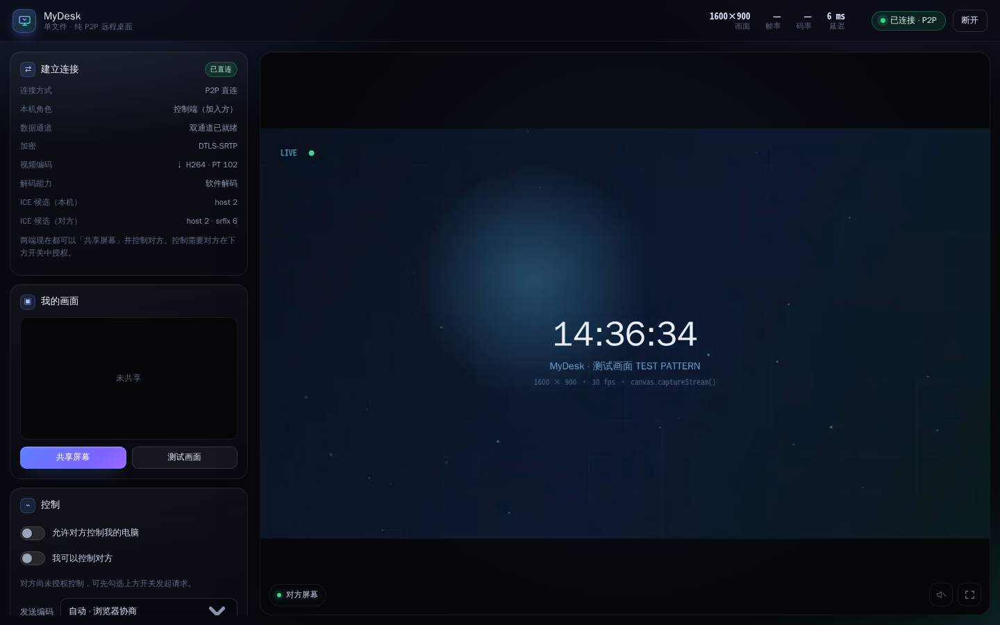

# MyDesk — server mode

A **P2P remote desktop that runs in the browser**: screen sharing plus remote
mouse/keyboard in both directions, with no relay in the media path.

This branch adds an **optional signaling server** so two people no longer have to
copy handshake strings by hand: create a room, send the link, done. The server
only relays SDP and ICE — the video, audio and input still go peer to peer,
encrypted with DTLS-SRTP.



## Two ways to connect

| Mode | When | How |
| --- | --- | --- |
| **Server** | The page is served over `http(s)` | Create a room → share the 8-character code or the link → the host approves the joiner before anything is sent. |
| **Manual** | `file://` or no server | Exchange one handshake string both ways. Works with zero infrastructure. |

Both modes use exactly the same media/control stack; the mode selector in the UI
switches between them.

## Quick start

### Docker (recommended)

```bash
docker build -t mydesk:local .
docker run -d --name mydesk -p 8080:8080 --restart unless-stopped mydesk:local
```

or

```bash
docker compose up -d
```

Then open `http://<host>:8080/` on both machines.

> Screen capture requires a secure context. `localhost` and HTTPS qualify;
> plain `http://192.168.x.x:8080` does **not** — browsers will block
> `getDisplayMedia` there. Put the container behind a TLS reverse proxy
> (Caddy, nginx, Traefik) when using it across the network.

### Node (no dependencies)

```bash
npm start            # or: node server.js
PORT=9000 node server.js
```

Node 20+ is required. There is nothing to `npm install`.

## Behind a tunnel or reverse proxy

Cloudflare Tunnel, nginx and friends all work, but two details bite:

**Use `127.0.0.1`, not `localhost`, in the ingress rule.** Docker publishes IPv4
only, and `localhost` can resolve to `::1` first:

```yaml
ingress:
  - hostname: desk.example.com
    service: http://127.0.0.1:6688
  - service: http_status:404
```

**If the tunnel client runs in its own container**, `127.0.0.1` means that
container, not the NAS. Use the host address instead — the NAS LAN IP, or
`http://host.docker.internal:6688` with
`--add-host=host.docker.internal:host-gateway` — or run the tunnel client with
`--network host`.

Port publishing is independent of this: `-p 6688:8080` publishes the container's
8080 on the host's 6688, so the ingress rule points at **6688**.

Quick check from the machine that runs the tunnel client:

```bash
curl -sv http://127.0.0.1:6688/healthz        # {"ok":true,...}
curl -i -H "Connection: Upgrade" -H "Upgrade: websocket" \
  -H "Sec-WebSocket-Version: 13" \
  -H "Sec-WebSocket-Key: dGhlIHNhbXBsZSBub25jZQ==" \
  https://desk.example.com/ws                 # HTTP/1.1 101
```

If `/healthz` answers but the tunnel returns 502, the origin address is wrong; if
the tunnel answers but `/ws` fails, the proxy is not forwarding the upgrade.

## Environment

| Variable | Default | Meaning |
| --- | --- | --- |
| `PORT` | `8080` | Listen port |
| `HOST` | `0.0.0.0` | Bind address |
| `ROOM_TTL_MS` | `1800000` | How long an unjoined room lives (30 min) |
| `ALLOW_ANY_ORIGIN` | `0` | Set to `1` to skip the WebSocket `Origin` check (only behind a proxy that rewrites `Host`) |
| `STRICT_ORIGIN` | `0` | Set to `1` to reject an `Origin`/`Host` mismatch instead of logging it |
| `MAX_CONNS` | `512` | Concurrent WebSocket connections before new upgrades get `503` (`0` = unlimited) |
| `MAX_ROOMS` | `256` | Rooms that may exist at once; beyond it `create` answers an error (`0` = unlimited) |
| `JOIN_RATE` | `40` | Machine-wide ceiling on `join` attempts per second. This is what keeps the 8-character code space from being enumerable (`0` = unlimited) |
| `JOIN_FAIL_BURST` | `12` | Failed `join` attempts allowed per connection per minute before it is put in a 5-minute cooldown |
| `EXIT_ON_UNCAUGHT` | `0` | Set to `1` to shut down on an uncaught exception instead of logging and carrying on |
| `TRUSTED_ORIGINS` | *(empty)* | Extra comma-separated origins to accept, e.g. `http://tauri.localhost`. The native desktop client runs inside WebView2, so its page origin is `tauri.localhost` — needed when `STRICT_ORIGIN=1` |
| `MYDESK_HTML` | `/app/MyDesk.html` | Path of the page to serve. Re-read when its mtime changes, so a bind mount updates the app without a rebuild |
| `HEALTHZ_DETAIL` | `0` | `1` adds `rooms` / `sockets` / `uptime` to `/healthz`. Off by default so a public deployment does not hand out free reconnaissance |

## HTTP surface

| Path | Purpose |
| --- | --- |
| `GET /` | The app (`MyDesk.html`) |
| `GET /healthz` | `{"ok":true}` — used by the Docker healthcheck; `HEALTHZ_DETAIL=1` adds `rooms`/`sockets`/`uptime` |
| `WS /ws` | Signaling socket |

## Releases

One rolling release, tag **`latest`**, rebuilt by `.github/workflows/release.yml` on
every push to `rust-desktop`. It is always the "Latest" release, so every link below
is stable:

```
https://github.com/urarattas/MyDesk/releases/latest/download/<file>
```

| File | What it is |
| --- | --- |
| `MyDeskBridge.exe` | Windows input bridge (`+ .sha256`) |
| `MyDesk-windows-x64-setup.exe` / `MyDesk-windows-x64.msi` | Desktop client, Windows |
| `MyDesk-linux-amd64.deb` / `MyDesk-linux-amd64.AppImage` | Desktop client, Linux — **no WebRTC in this build, capture and injection only** |
| `MyDesk.html` | Standalone single-file app (`+ .sha256`) |
| `SHA256SUMS.txt` | Checksums for everything above |

The signaling server image is not a release asset; it goes to GHCR with a matching
`latest` tag:

```bash
docker pull ghcr.io/urarattas/mydesk:latest
```

`MyDesk.html` is also served by a running instance at `/MyDesk.html`.

`ci.yml` only runs tests (server + bridge + `mydesk-core`); it publishes nothing.

## Signaling protocol

```text
client -> server  {"type":"create"}                        -> {"type":"room","code":"ABC123"}
client -> server  {"type":"join","code":"ABC123"}          -> {"type":"joined"}
                                                            and {"type":"peer"} to the host
client -> server  {"type":"offer"|"answer","sdp":"..."}    relayed verbatim to the other peer
client -> server  {"type":"ice","candidate":{...}}         relayed verbatim
client -> server  {"type":"bye"}                           relayed verbatim
server -> client  {"type":"peer-left"} | {"type":"error","message":"..."}
```

A room holds exactly two peers. The first one creates it and becomes the host
(offerer); the second joins and answers. Rooms are deleted as soon as one side
disconnects, and garbage-collected if nobody ever joins.

The host does not offer automatically: on `{"type":"peer"}` the page asks the
person in front of it to approve, and only then sends `offer`. Denying (or 45
seconds of silence) sends `bye` and closes the room. `join` is rate limited as
described above, so a rejected attempt is not a free retry.

## Security notes

**What protects a session**

- The room code plus a confirmation click on the host. An 8-character code from a
  32-symbol alphabet is `32^8 ≈ 1.1e12` possibilities, so it is treated as a
  *hint*, not a secret: the host now has to approve the joiner before any offer is
  sent (`#peerAsk` in the page). Nothing is shared with a stranger who merely
  guesses the code.
- `join` is throttled twice — per connection (`JOIN_FAIL_BURST` failures/minute,
  then a 5-minute cooldown) and machine-wide (`JOIN_RATE` attempts/second). Without
  that, a single socket can try ~10k codes per second and land in somebody's
  waiting room within minutes.
- Cross-site pages are refused at the upgrade: browsers always send
  `Sec-Fetch-Site`, and anything other than `same-origin`/`none` gets `403`. This
  is proxy-rewrite-proof, unlike the `Origin`/`Host` comparison, which still only
  warns unless `STRICT_ORIGIN=1`.
- The served page carries `X-Frame-Options: DENY` and
  `Content-Security-Policy: frame-ancestors 'none'` so a remote-control UI cannot
  be clickjacked inside someone else's iframe.
- Room links use `#room=…` instead of `?room=…`: a fragment is never sent to the
  server, never lands in a reverse-proxy access log and never leaks via `Referer`.

**What the server sees**

- SDP and ICE candidates (which contain IP addresses), never media, input or
  clipboard content.
- Malformed request targets get `400` instead of throwing; oversized or
  never-terminated WebSocket fragments are cut off at 512 KiB with close code
  `1009`. Both used to be one-packet ways to kill the process.

**Deployment**

- Put it behind TLS in any real deployment; `ws://` signaling is readable on the
  path.
- There is still no authentication in front of `/`. If you expose it to the
  internet, put an authenticating proxy or a VPN in front — otherwise every
  visitor gets a working room service and a share of your `JOIN_RATE` budget.
- The process runs as the unprivileged `node` user in the image and exposes one
  port. It holds no state on disk.
- `uncaughtException` is logged and the process keeps serving (rooms live only in
  memory, so exiting would drop every session). Set `EXIT_ON_UNCAUGHT=1` if you
  prefer a supervisor to restart it instead.

## Native desktop client (Rust)

`desktop/` is a **Tauri 2** desktop app that runs this very page inside WebView2, so
the signaling protocol and the whole WebRTC stack are identical and either end can
be a browser. Rust only adds what a webview cannot do — native input injection and
a native screen-capture fallback — which removes `bridge.py` entirely:

```text
web:       peer input -> DataChannel -> browser -> HTTP POST 127.0.0.1:8765 -> bridge.py -> OS
desktop:   peer input -> DataChannel -> WebView2 -> Tauri command           -> enigo    -> OS
```

```bash
cd desktop && cargo build --release
./target/release/mydesk
```

Server address, mode (server/manual) and the remote-control permission live in
`config.toml` (see [desktop/config.example.toml](desktop/config.example.toml)).
Measured on a 2560×1440 screen: native capture ~45 ms/frame, JPEG ~17 ms,
end-to-end video ~16 fps, and injected input lands on the exact predicted pixel.
Details and known gaps: [desktop/README.md](desktop/README.md).

## Optional input bridge

Browsers cannot inject OS-level input. Two forms of the same agent are available
from the **系统级操控** panel:

- `bridge/bridge.py` — `pip install pynput` and run it.
- `MyDeskBridge.exe` — packaged with PyInstaller, no Python needed. Download it
  from the [releases page](https://github.com/urarattas/MyDesk/releases); CI builds
  and smoke-tests it on `windows-latest` for every change under `bridge/`. The
  binary is unsigned, so verify the `.sha256` published next to it
  (`certutil -hashfile MyDeskBridge.exe SHA256`) before running it.

Releases come from CI: every push to `rust-desktop` refreshes the single `latest`
release, which ships `MyDeskBridge.exe` plus its SHA-256, so
`https://github.com/urarattas/MyDesk/releases/latest/download/MyDeskBridge.exe`
always resolves once the workflow has run.

Both listen on `127.0.0.1:8765` only, and both **require a pairing token**: the
process prints one at startup, and you paste it into **系统级操控 → 配对令牌**.
Binding loopback is not enough on its own — the browser runs on the same machine,
so any web page you visit can reach `127.0.0.1`. Without the token a request gets
`401`; with a `Host` that is not loopback (DNS rebinding) it gets `403`. See
[bridge/README.md](bridge/README.md).

Control is engaged by clicking the video: **Esc releases it, clicking again resumes**.
While engaged the page requests a [keyboard lock](https://developer.chrome.com/docs/web-platform/keyboard-lock),
so shortcuts that normally belong to the browser (Ctrl+W, Ctrl+T, F11) are delivered to the
remote machine instead. Keyboard lock needs Chrome/Edge on a secure context; without it those
combinations still act locally. `Ctrl+W`-style tab shortcuts are the main ones a page can never
intercept on its own.

## Development

```bash
npm test        # starts the server, drives two WebSocket clients end to end
```

The test uses only Node built-ins (global `WebSocket` since Node 22), so CI does
not need an install step either.

## CI

`.github/workflows/ci.yml` runs on pushes to `server` and on pull requests:

1. **test** — `npm test` on Node 22.
2. **docker** — builds the image with Buildx, tags it with the branch, the short
   and `latest` + `sha-<short>` tags, pushed to `ghcr.io/<owner>/<repo>`
   (`GITHUB_TOKEN`, no extra secret needed).

Images are published for pushes only; pull requests just build.

## Branches

| Branch | Contents |
| --- | --- |
| `main` | Single-file app, no server. |
| `single-file` | Same as `main`. |
| `server` | This branch: signaling server, Docker image, CI. |

## License

No license has been chosen for this repository yet.
